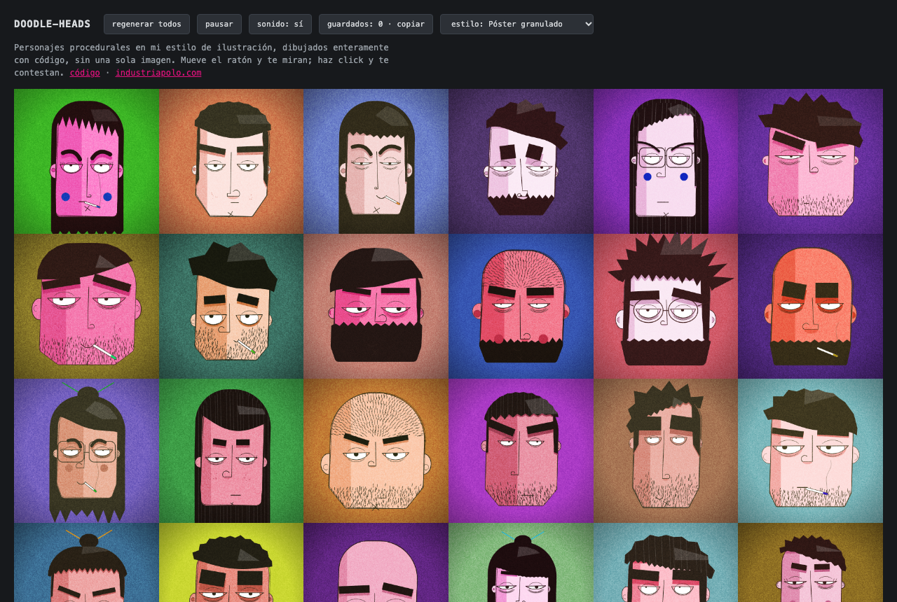

# Doodle heads

Procedural characters in my illustration style, drawn entirely in code — not a single image.

## Live demo

**[industriapolo.github.io/doodle-heads](https://industriapolo.github.io/doodle-heads/)**

Move the mouse and they look at you. Hover one and it pays attention. Click it and it
answers, in its own voice.



## What it is

Thirty characters, all different, none of them drawn by hand. Every face is composed at
runtime on a 2D canvas from a seed: silhouette, hair masses, eyes, brows, nose, mouth,
glasses — plus a colour palette derived in HSL from a handful of numbers.

No images, no dependencies, no bundler, no build step. Same seed, same character, always.

They are also alive. A shared animation loop drives blinking, gaze, mood drift and
reactions across all thirty, and each one speaks a wordless babble synthesised with Web
Audio — no audio assets either.

## How it's built

- **One module per feature.** `src/parts/` holds eleven of them — `head`, `hair`, `eyes`,
  `brows`, `nose`, `mouth`, `chin`, `ears`, `cheeks`, `glasses`, `voice`. Never a monolith.
- **One preview per module.** `previews/` is the workbench: each page renders ~30 variants
  with live sliders, so a feature gets tuned in isolation before it goes into a face.
  `previews/compose.html` is the full panel.
- **Characters are serializable parameters.** A whole character is a plain object of
  numbers and strings. Ranges are *declared data*, not code, which is what lets the UI read
  and edit them — directing the generator means moving a band, not editing a file.
- **Deterministic seeds.** Every random draw goes through `mulberry32`, and each part gets
  its own forked lane, so adding a parameter to the mouth doesn't repaint every saved face.
- **Style is centralised** in `src/style/`. No part hardcodes a colour or a line weight.
- **Tests run with `node --test`** — 347 of them, no test framework. They cover the draw
  (determinism, parameter contracts, archetype statistics over 2,000 seeds) and the timing
  of the animation rig, both headless. The drawing itself is judged by eye in the previews.

Everything draws in a logical 800×800 space; `src/core/canvas.js` handles the device pixel
ratio so no module ever thinks about it.

## How I built it with Claude Code

The whole thing was written with [Claude Code](https://claude.com/claude-code) across a
few dozen sessions, and the method mattered more than any single prompt. The working
documents are in the repo and they are the actual trail:

- **[`generador-personajes-kickoff.md`](generador-personajes-kickoff.md)** — the spec I
  wrote before any code: the style, the constraints, the acceptance criteria.
- **[`CLAUDE.md`](CLAUDE.md)** — the rules the agent reads at the start of every session.
  Not just conventions: the closed decisions, the traps already paid for, and *why* each
  one is the way it is. It is the file that keeps a new session from re-litigating
  something that was settled three weeks ago.
- **The previews** — the feedback loop. Tuning one feature across thirty variants at once,
  with sliders, is how a generator gets art-directed. Describing a face in prose does not
  work; moving a band and looking does.
- **[`AUDITORIA-2026-08-28.md`](AUDITORIA-2026-08-28.md)** and
  **[`AUDITORIA-2026-08-30.md`](AUDITORIA-2026-08-30.md)** — periodic audits of the whole
  codebase, with findings ranked and then closed in later sessions.
- **[`HANDOFF.md`](HANDOFF.md)** — state between sessions: what exists, what's pending, and
  a list of known traps so they don't get rediscovered the hard way.

> Working docs are in Spanish. They're the real record of the process, so they stay as
> they were written.

## The hard part

Claude could write any of this code. What it couldn't do was tell me whether a nose looked like one of mine. Most of the work was building the loop that lets me judge that, and four problems took most of the time.

**Making it look drawn, not generated.** Describing a face in words got me generic faces. What worked was one preview per feature, thirty variants at once, sliders, and looking. The nose took four rounds to stop being a bump stuck on top of the line and become a curl of the stroke itself. Hair was worse. The first version approximated the skull with an ellipse and patched the gaps, and in 53% of faces the scalp showed through somewhere; every patch added new breaks in the silhouette. The fix was to stop approximating: hair and beard masses now inherit the head's real contour. Zero failures in 190 faces.

**A voice with no audio files.** Each character babbles with a voice synthesised in Web Audio. It went through several recipes and two diagnoses that turned out wrong. The worst problem wasn't in the sound: the noise was random, so the same phrase sounded different on every reload, and I couldn't tell whether a change had improved anything or just rerolled the noise. Making the noise deterministic, then putting recipes side by side and letting the ear decide, is what got it there. I had been fixing what I knew how to measure, not what sounded wrong.

**A tuning bug nobody could see.** The panel compared every setting exactly against its default, so a rounding error or half a slider step was enough to override an archetype. Long hair in women dropped from 85% to 10% without anyone touching it. An audit found it. Now the panel stores only what was actually changed, with a tolerance, and a test guards it.

**Thirty at once.** Every face repaints when the mouse moves. Splitting each one into a cached static layer and a live layer cut the cost of a repaint by 77%.

## References

The illustrations in [`referencias/`](referencias/) are mine, from my blog
[caosexpresivo.tumblr.com](https://caosexpresivo.tumblr.com). They are there only to
direct the style — they are never loaded at runtime, and the rule that there are zero
image assets holds for all of them.

The technique that started this was inspired by a thread from
[@albertobeicas](https://x.com/albertobeicas).

## Run locally

```bash
python3 serve.py          # http://localhost:8137
node --test               # from the repo root
```

Use `serve.py`, **not** `python3 -m http.server`. The latter sends no `Cache-Control`, so
Chrome applies heuristic caching and serves ES modules from memory without revalidating:
you edit a module, reload, and the old one is still running — and with namespace imports
that doesn't fail loudly, it just gives you `undefined` on a property and a blank page
halfway through startup. `serve.py` sends `no-store` and strips `Last-Modified`.

Add `?dev` to the demo URL for the workshop view: the fps counter and the style source
selector.

## License

© 2026 Jorge Polo. Code shared for reference; not licensed for reuse.

The illustration style and the reference images are part of my visual identity, and the
style lives in the code itself — which is why there is no open-source licence here. Read
it, learn from it, ask me if you want to do something with it.
